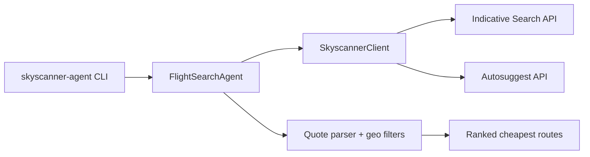

# Skyscanner Flight Agent

Find the **cheapest indicative fares** across your origin airports, destination countries/regions, and travel windows — using Skyscanner Partner API features that mirror the consumer site's **Everywhere** (`anywhere`) and **Anytime** (`anytime`) exploration.

## Prerequisites

1. **Skyscanner Partner API key** — apply at [Skyscanner Partner Portal](https://partners.skyscanner.net/).
2. Python 3.11+

Indicative prices are cached estimates (great for discovery). For bookable live fares, extend the client with the Live Prices create/poll flow.

## Setup

```bash
cd /agent
python -m venv .venv
source .venv/bin/activate
pip install -e ".[dev]"
export SKYSCANNER_API_KEY="your-key-here"
```

## Quick start

Print an example config:

```bash
skyscanner-agent example-config > config.yaml
```

Run with YAML (recommended):

```bash
skyscanner-agent search -c config.yaml
```

Run from CLI flags:

```bash
skyscanner-agent search \
  --origins DEL,BOM,LHR \
  --destinations anywhere \
  --continents Europe,Southeast\ Asia \
  --date-mode range \
  --from-month 2026-06 \
  --to-month 2026-09 \
  --market IN \
  --currency INR \
  --top 25
```

Anytime search (Skyscanner "Anytime"):

```bash
skyscanner-agent search \
  --origins LHR \
  --destinations anywhere \
  --continents Europe \
  --date-mode anytime \
  --currency GBP
```

Explicit countries/cities instead of everywhere:

```bash
skyscanner-agent search \
  --origins DEL \
  --destinations list \
  --places "Spain,Thailand,Japan" \
  --date-mode range \
  --from-month 2026-07 \
  --to-month 2026-08
```

JSON output for automation:

```bash
skyscanner-agent search -c config.yaml --json
```

## How it maps to Skyscanner UI

| Your goal | Config | API |
|-----------|--------|-----|
| Flying from several home airports | `origins: [DEL, BOM, ...]` | One indicative query per origin |
| "Everywhere" destination | `destinations.mode: anywhere` | `destinationPlace: { "anywhere": true }` |
| Filter by continent / region | `continents:` | Post-filter on API results (continents are **not** valid indicative destinations) |
| Named countries | `countries:` or `mode: list` + `places` | Country `entityId` via autosuggest |
| Flexible dates in a window | `dates.mode: range` + `start`/`end` | `dateRange` + grouping by date/month |
| Fully flexible dates | `dates.mode: anytime` | `anytime: true` + monthly grouping |

## Architecture



## Environment variables

| Variable | Description |
|----------|-------------|
| `SKYSCANNER_API_KEY` | Partner API key (required) |

## Tests

```bash
pytest
```

## Limitations

- Requires an approved Skyscanner partner key; without it, API calls will fail.
- Continents cannot be passed directly to the indicative API; this agent uses **`anywhere`** plus geographic filters (same practical outcome as narrowing Everywhere results).
- Indicative prices are not guaranteed live booking prices.
- Return-trip indicative searches use symmetric date settings on both legs; tune in `config.yaml` as Skyscanner documents for your market.

## License

MIT
